<picture>
  <source media="(prefers-color-scheme: dark)" srcset="brand/hero-dark.svg">
  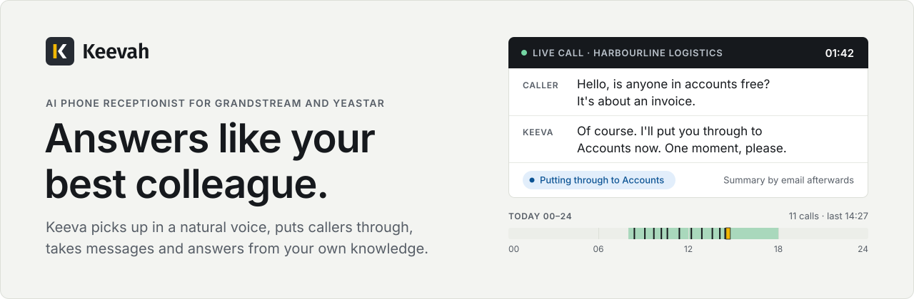
</picture>

  
  
  

  <a href="#editions-and-download">Download</a> ·
  <a href="docs/getting-started.md">Getting started</a> ·
  <a href="ROADMAP.md">Roadmap</a> ·
  <a href="CHANGELOG.md">Changelog</a> ·
  <a href="SUPPORT.md">Support</a>

## What it does

Keevah answers your business's phone calls with an AI receptionist. Callers ring your usual number. Keeva picks up in a natural voice, finds out who's calling and why, then puts them through to the right department, takes a message, books an appointment, or answers their question from your own documents. Your team sees every call as it happens, with a transcript afterwards and a summary by email.

It works with the Grandstream and Yeastar phone systems you already have. One Keevah server can run reception for many organisations, each with its own receptionist, voice, opening hours and knowledge. You name the receptionist and choose from ten voices.

**New in 1.16:** appointment booking with Google and Outlook calendars, returning callers and Contacts, spam and robocall blocking, frustrated callers offered a person, webhooks and an API, and caller data requests. See the [changelog](CHANGELOG.md).

## Key features

### On the phone

<table>
  <tr>
    <td width="52" valign="top"></td>
    <td valign="top"><strong>Answers every call</strong> Keeva picks up at any hour in a natural voice, lets the caller explain, and asks one thing at a time. Name her, pick one of ten voices from a short list, and hear it before you save.</td>
    <td width="52" valign="top"></td>
    <td valign="top"><strong>Puts callers through</strong> To a department, or to a person by name. Each department chooses cold, straight through, or warm, where Keeva asks your colleague first. Callers can press 0 for a person at any time.</td>
  </tr>
  <tr>
    <td valign="top"></td>
    <td valign="top"><strong>Takes messages</strong> When nobody's free, or you're closed, she takes a message and a number to ring back. It waits under Messages to return until someone marks it returned.</td>
    <td valign="top"></td>
    <td valign="top"><strong>Answers from your knowledge</strong> Add PDF and Word files, web pages and short notes. Keeva answers from them, gives contact details exactly as written, never made up, and says so when she doesn't know.</td>
  </tr>
  <tr>
    <td valign="top"></td>
    <td valign="top"><strong>Books appointments</strong> Connect Google Calendar or Microsoft 365 / Outlook. Keeva finds free times, books, moves and cancels appointments during the call, and checks again before booking so nothing is double-booked.</td>
    <td valign="top"></td>
    <td valign="top"><strong>Knows returning callers</strong> Keeva knows when a number has called before, checks the name before using it, and knows if their message is still waiting. Callers who give their name are saved to Contacts.</td>
  </tr>
  <tr>
    <td valign="top"></td>
    <td valign="top"><strong>Notices frustrated callers</strong> When a caller asks for a person, repeats themselves or sounds upset, Keeva offers a person, or puts them through straight away. The call shows Needs attention on the dashboard.</td>
    <td valign="top"></td>
    <td valign="top"><strong>Blocks spam and robocalls</strong> Block numbers or whole prefixes, keep an allow list, and block from a call in one click. Likely spam is flagged. Blocked callers never reach the AI and don't count as usage.</td>
  </tr>
  <tr>
    <td valign="top"></td>
    <td valign="top"><strong>Waiting audio</strong> A hold tone, built-in music or your own audio, with spoken waiting messages, for the organisation or each department. Callers hear it on every transfer and while they wait for the fallback.</td>
    <td valign="top"></td>
    <td valign="top"><strong>Greets your staff</strong> Colleagues ringing from their extension are greeted by first name, however your phone system writes the number. With a PIN, they can have Keevah dial an outside number for them.</td>
  </tr>
  <tr>
    <td valign="top"></td>
    <td valign="top"><strong>AI notice on every call</strong> Every call opens with a short recorded notice that the caller is talking to an AI and that the call is transcribed. Reword it if you like; it can't be switched off.</td>
    <td valign="top"></td>
    <td valign="top"><strong>Opening hours</strong> Hours and a time zone for each organisation. Out of hours, Keeva takes a message and tells the caller when you reopen.</td>
  </tr>
</table>

### For your team

<table>
  <tr>
    <td width="52" valign="top"></td>
    <td valign="top"><strong>Live dashboard</strong> Who's on the line now, calls and minutes, how calls ended, what callers wanted and your busiest hours, for any dates. Take a live call to your own phone, or send it to the fallback. Light and dark, on desktop and phone.</td>
    <td width="52" valign="top"></td>
    <td valign="top"><strong>Call logs and transcripts</strong> Every call is logged with its transcript, an AI summary and action items, encrypted on the server. Filter, export to CSV, resend the summary or email a call to a colleague.</td>
  </tr>
  <tr>
    <td valign="top"></td>
    <td valign="top"><strong>Email summaries</strong> A summary of each call goes to the address each organisation chooses, and call notes to the department a caller was put through to. The transcript stays out unless they switch it on.</td>
    <td valign="top"></td>
    <td valign="top"><strong>Members, roles and permissions</strong> Invite people by email as an Owner, Admin, Manager, Receptionist or Staff, or make your own roles with just the permissions they need. One login can belong to several organisations. Two-step sign-in, signed-in devices and an audit log of who changed what.</td>
  </tr>
  <tr>
    <td valign="top"></td>
    <td valign="top"><strong>Many organisations</strong> Run reception for many organisations from one server. Each has its own receptionist, voice, departments, hours and knowledge, and sees only its own calls.</td>
    <td valign="top"></td>
    <td valign="top"><strong>Usage and AI cost</strong> Calls and minutes for each organisation, month by month, and an estimate of the AI cost for super admins, with CSV downloads.</td>
  </tr>
  <tr>
    <td valign="top"></td>
    <td valign="top"><strong>Webhooks and API</strong> Tell your CRM or helpdesk when a call starts or ends, a message is taken, a caller is put through or an appointment is booked, with signed webhooks. API tokens read calls and messages.</td>
    <td valign="top"></td>
    <td valign="top"><strong>Caller data requests</strong> When a caller asks what you hold about them, find everything by their number or name, download it, or erase it without touching anyone else's. You can also stop recording or transcribing a number.</td>
  </tr>
</table>

### Running Keevah

<table>
  <tr>
    <td width="52" valign="top"></td>
    <td valign="top"><strong>Setup checklist and test calls</strong> Each organisation sees what's done and what's missing. A test call rings a phone through your own line, so you hear exactly what callers hear.</td>
    <td width="52" valign="top"></td>
    <td valign="top"><strong>Grandstream and Yeastar</strong> Works with Grandstream UCM and Yeastar S-Series systems, connected through Asterisk. Keevah joins your phone system as one extension, and your numbers stay as they are.</td>
  </tr>
  <tr>
    <td valign="top"></td>
    <td valign="top"><strong>Backups</strong> Encrypted backups daily, weekly or monthly, to a folder, a NAS, a network share or S3-compatible cloud storage, all set up from the dashboard. Back up now, one organisation or everything, and keep or download it. A restore checks every file first.</td>
    <td valign="top"></td>
    <td valign="top"><strong>Updates and rollback</strong> On a Linux server, System health shows each new release and its notes. Update now or at a time you choose, with a backup taken first, and roll back to an earlier version from the dashboard if you need to.</td>
  </tr>
  <tr>
    <td valign="top"></td>
    <td valign="top"><strong>Outage alerts</strong> Super admins are emailed when the phone service, Gemini, a phone line, the email server or the backups fail, and again when they recover. System health puts problems first.</td>
    <td valign="top"></td>
    <td valign="top"><strong>Kept private</strong> Callers can't talk Keeva out of her instructions, and such calls are marked. Keys, tokens and passwords are taken out of every log line, and transcripts, summaries and messages are encrypted.</td>
  </tr>
</table>

## How it works

<picture>
  <source media="(prefers-color-scheme: dark)" srcset="brand/how-it-works-dark.svg">
  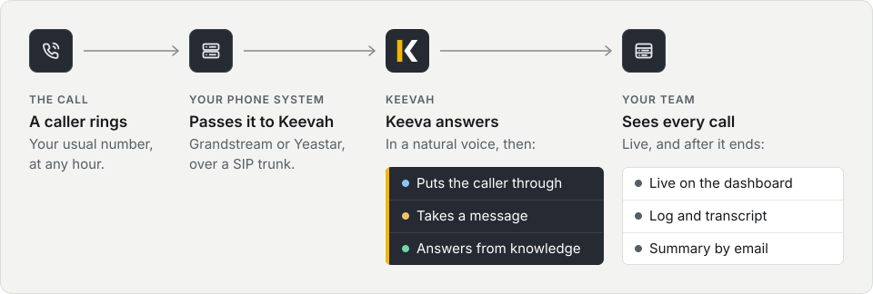
</picture>

1. **A caller rings your usual number.** Your Grandstream or Yeastar phone system passes the call to Keevah, which is set up on it as one extension.
2. **Keeva answers.** The AI notice plays, then she greets the caller for your organisation, in your chosen voice, and finds out what they need.
3. **She deals with it.** She puts the caller through to the right department, takes a message, or answers from your knowledge.
4. **Your team sees every call.** It shows on the dashboard while it's happening, then in Call logs with the transcript, a summary and action items, and the summary goes out by email.

If something goes wrong, callers still reach a person: when the AI can't be reached, or Keevah's phone service is down, calls go to the organisation's fallback extension, and the super admins are emailed.

Keeva's voice and understanding come from Google Gemini. The dashboard, the call records and the knowledge base stay on the server Keevah runs on.

## Screenshots

Every screenshot uses demo data: the organisations, people and calls in them are made up.

<picture>
  <source media="(prefers-color-scheme: dark)" srcset="screenshots/dashboard-group-dark.png">
  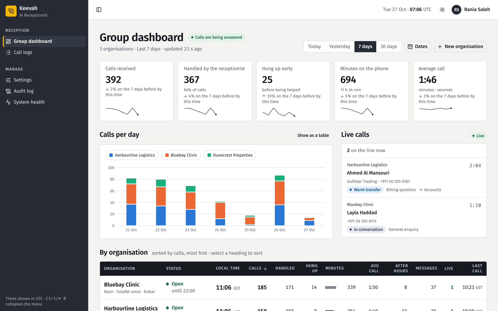
</picture>

<strong>Group dashboard.</strong> Three organisations over seven days: headline numbers, calls per day, who's on the line now, and the board by organisation. Demo data.

<picture>
  <source media="(prefers-color-scheme: dark)" srcset="screenshots/call-transcript-dark.png">
  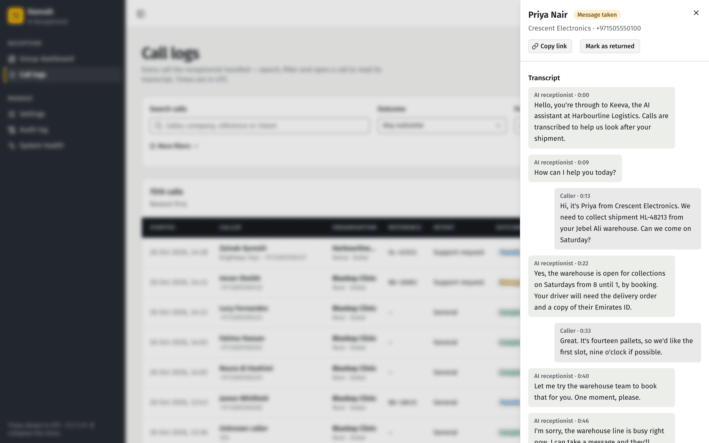
</picture>

<strong>A call's transcript.</strong> It opens with the AI notice, answers a question about Saturday collections from the organisation's knowledge, then takes a message. Demo data.

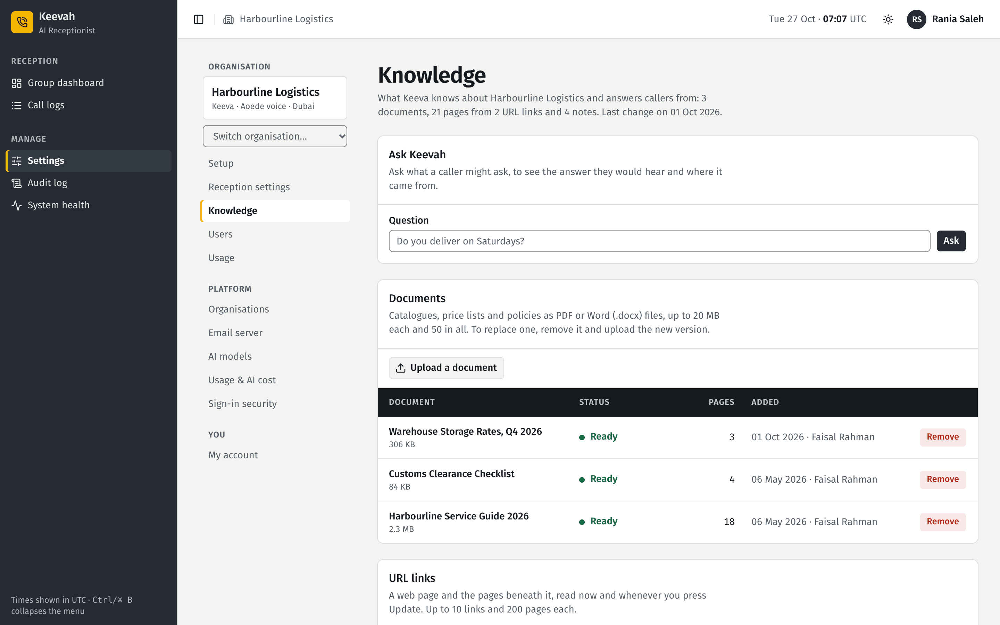

<strong>Knowledge.</strong> What Keeva knows about an organisation, Ask Keevah to try a question the way a caller would, and the documents she answers from. Demo data.

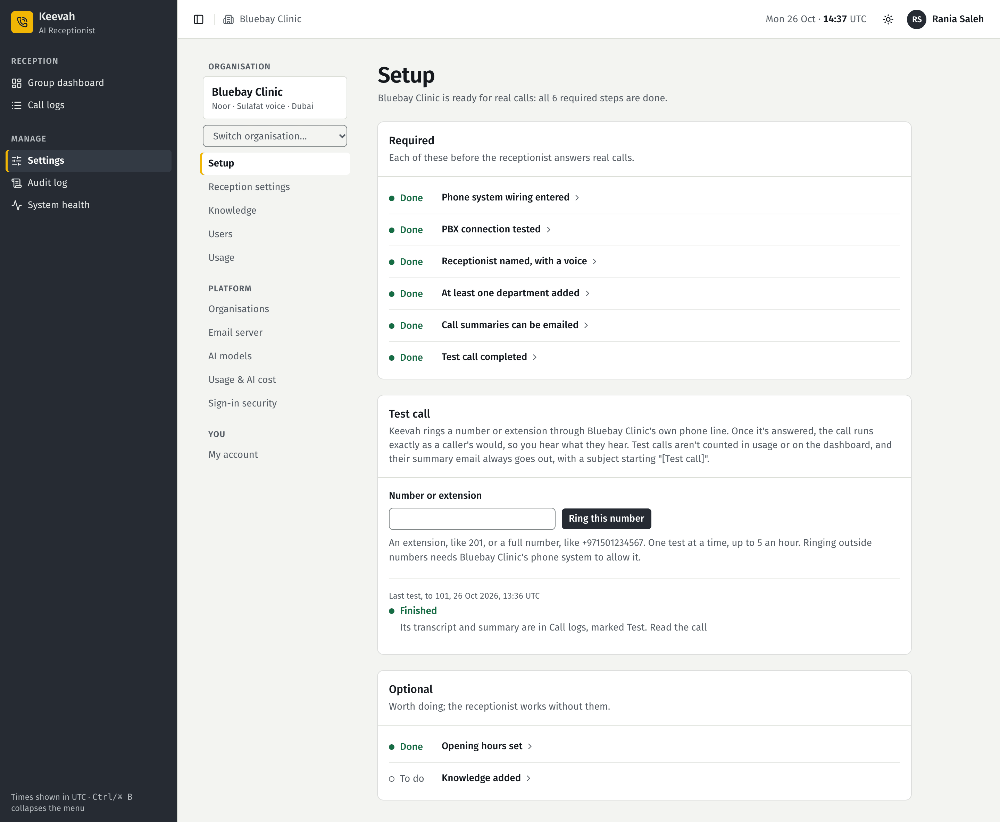

<strong>Setup.</strong> The checklist an organisation works through before real calls, with a finished test call. Demo data.

<strong>More screenshots</strong> (9)

 

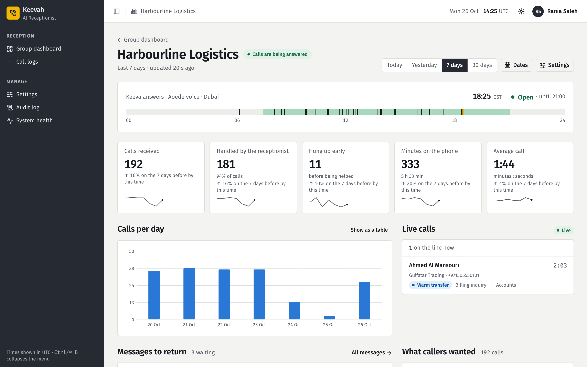

<strong>One organisation's dashboard.</strong> Its day at a glance on a 24-hour strip, the headline numbers, calls per day and messages to return. Demo data.

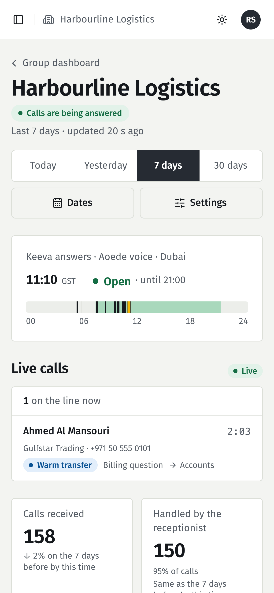

<strong>On a phone.</strong> The same dashboard at phone width. Demo data.

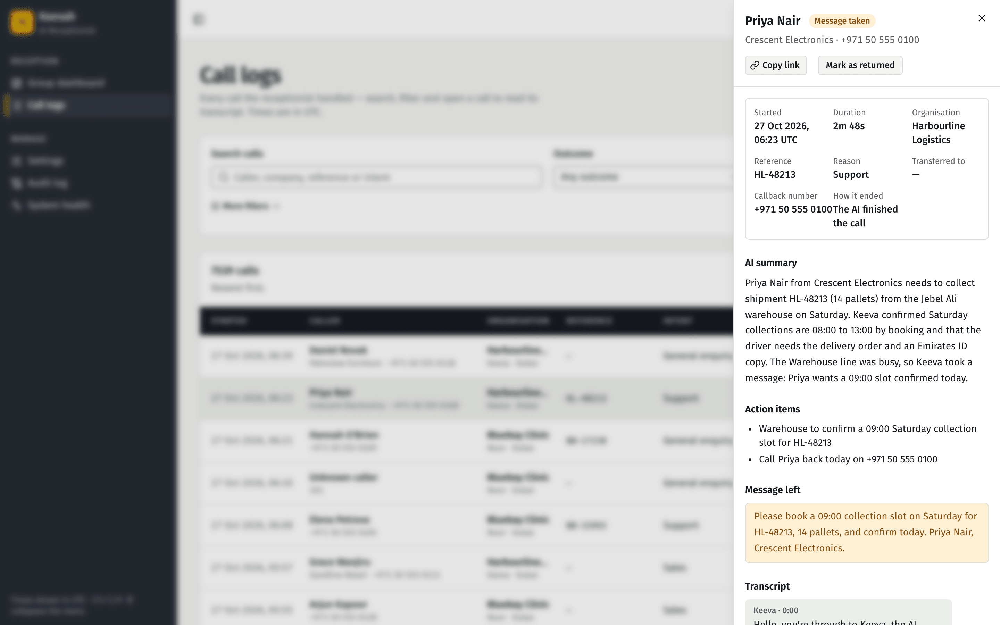

<strong>A call's details.</strong> Who called and why, the AI summary, action items and the message left, with Mark as returned. Demo data.

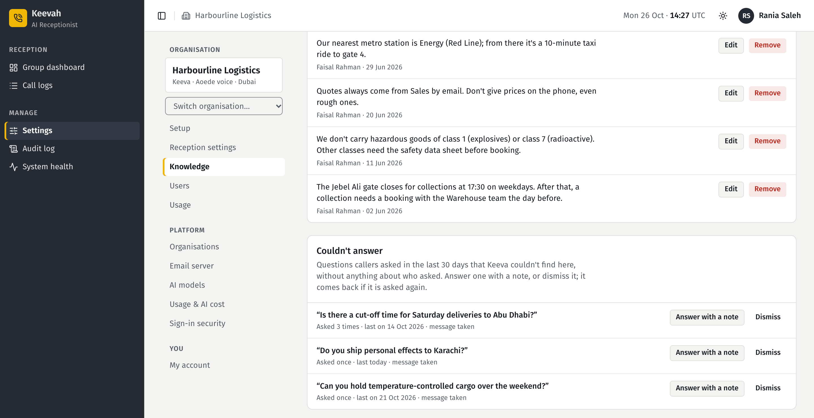

<strong>Notes and Couldn't answer.</strong> Short facts typed in, and the questions Keeva couldn't answer, ready to answer with a note. Demo data.

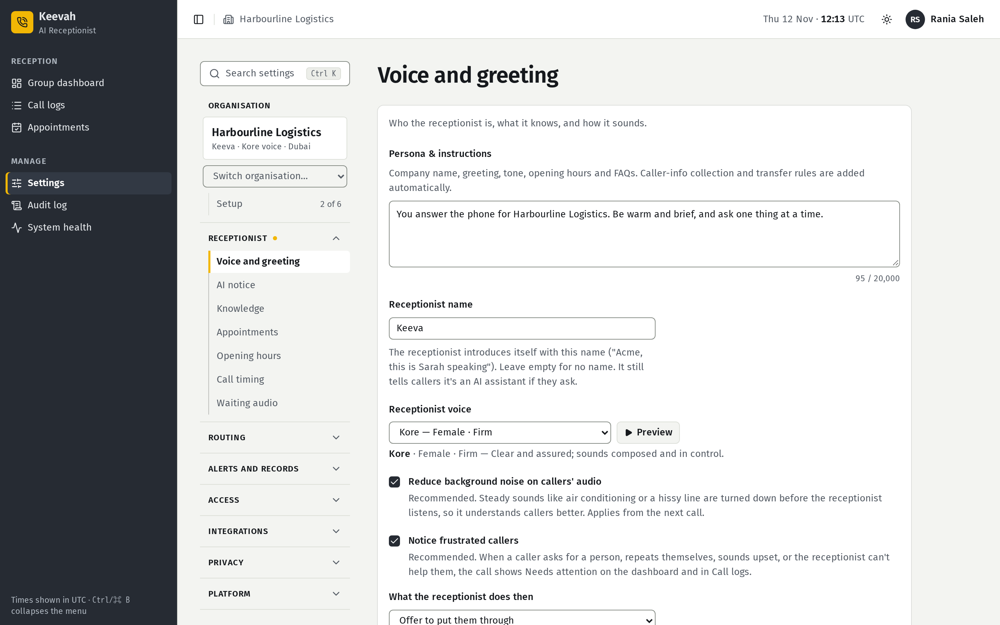

<strong>Voice and greeting.</strong> The Settings menu grouped by what you came to do, the receptionist's name, the voice picked from a short list with Preview, and what to do about frustrated callers. Demo data.

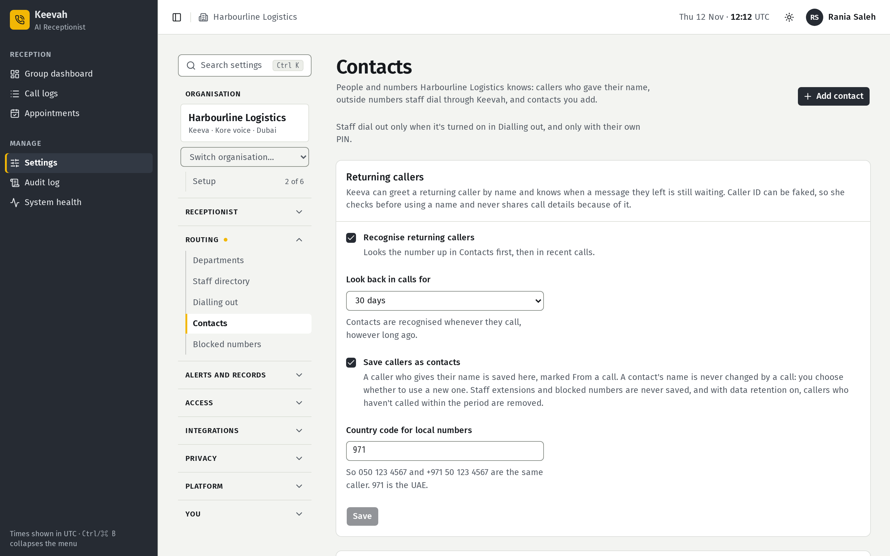

<strong>Contacts and returning callers.</strong> Keeva recognises numbers that have called before and saves callers who give their name. Demo data.

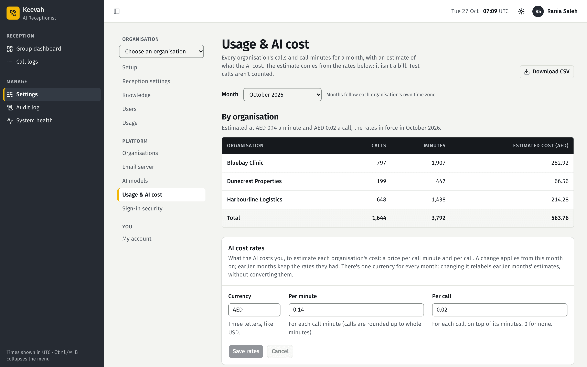

<strong>Usage &amp; AI cost.</strong> A month's calls, minutes and estimated AI cost for every organisation, and the rates behind it. Demo data.

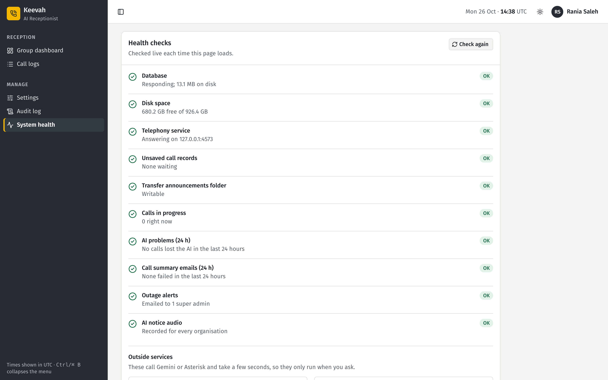

<strong>System health.</strong> The platform's checks on one page. Demo data, from a demo server.

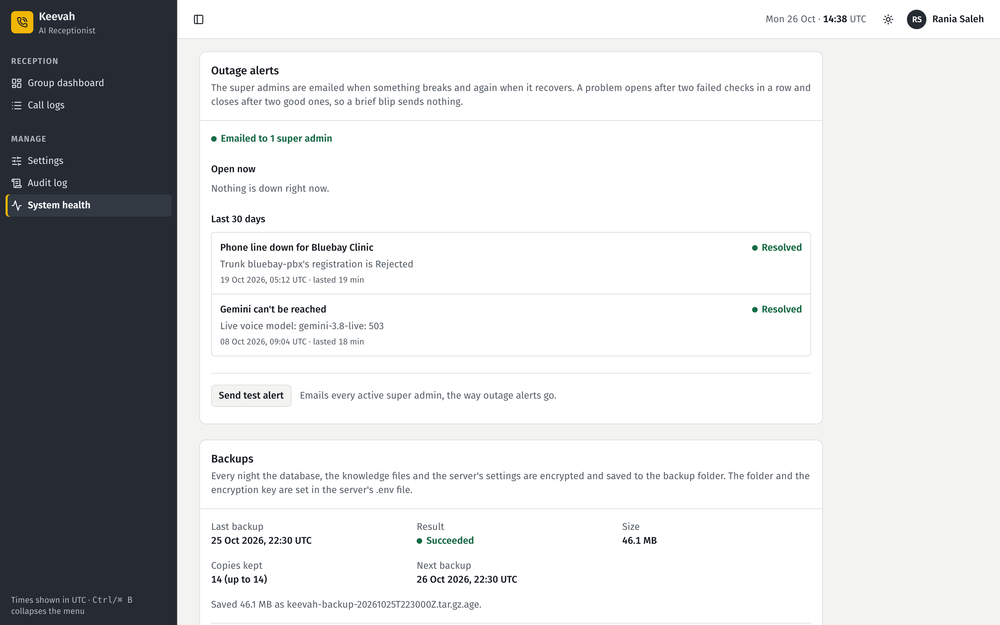

<strong>Outage alerts and backups.</strong> Two resolved incidents from the last 30 days, and the last nightly backup. Demo data.

## Editions and download

Keevah comes as a **Preview** package for each system. Download the zip for yours from the [latest release](https://github.com/b34tl86/Keevah/releases/latest), check it against `SHA256SUMS.txt` on the same page, then follow [Getting started](docs/getting-started.md).

| Edition | File on the release page | Dashboard | Answers live calls |
|---|---|---|---|
| Windows | `keevah-<version>-windows.zip` | Yes | Not yet |
| macOS | `keevah-<version>-macos.zip` | Yes | Not yet |
| Linux | `keevah-<version>-linux.zip` | Yes | Yes, with Asterisk set up beside it |

**Preview** means the dashboard runs on all three systems, but answering live calls needs Linux with Asterisk. Built-in Asterisk, with installers for Windows, macOS and Linux, is on the [roadmap](#roadmap) as Next.

The packages aren't signed yet, so Windows and macOS warn you the first time you open Keevah. [Getting started](docs/getting-started.md) shows what to press.

To run Keevah for your business, on your own phone lines, talk to [TechTrust](https://techtrust.ae).

## Roadmap

<picture>
  <source media="(prefers-color-scheme: dark)" srcset="brand/roadmap-dark.svg">
  
</picture>

| Version | Milestone | Status |
|---|---|---|
| v0.9 | Group dashboard and reception settings | Shipped |
| v1.0 | Knowledge base and commercial launch pack: usage & AI cost, AI notice, setup checklist and test calls, invites, backups, outage alerts | Shipped |
| v1.1–1.9 | Cold or warm transfers, callers asking for a person by name, staff dialling out, updates from the dashboard | Shipped |
| v1.10–1.13 | Settings a page per job, Receptionist and custom roles, taking a live call, backups to a NAS or the cloud | Shipped |
| v1.14–1.15 | Waiting audio, staff recognition, backing up before an update, rolling back from the dashboard | Shipped |
| v1.16 | Appointment booking, returning callers and Contacts, spam and robocall blocking, frustrated callers, webhooks and API, caller data requests | Shipped |
| — | [Arabic and other languages on calls](https://github.com/b34tl86/Keevah/issues/33) | Now |
| — | [Data residency](https://github.com/b34tl86/Keevah/issues/34): where call data is processed, and in-country options | Now |
| — | Built-in Asterisk, Keevah Connector and installers for Windows, macOS and Linux, with [signed packages](https://github.com/b34tl86/Keevah/issues/9) | Next |
| — | [Call recording](https://github.com/b34tl86/Keevah/issues/32): playback, retention and a notice to callers | Next |
| — | [Concurrent call limits](https://github.com/b34tl86/Keevah/issues/36) per organisation and per server | Next |
| — | [Licensing](https://github.com/b34tl86/Keevah/issues/26): a licence for each Keevah server | Next |
| — | [SMS and WhatsApp messages](https://github.com/b34tl86/Keevah/issues/38) to callers and staff | Later |
| — | [Themes](https://github.com/b34tl86/Keevah/issues/22): your branding, colours and fonts | Later |
| — | [Signed updates](https://github.com/b34tl86/Keevah/issues/10) and [audited support access](https://github.com/b34tl86/Keevah/issues/15) | Later |
| — | techtrust.ae product website | Later |
| — | Android app for personal calls | Later |

Nothing on the roadmap has a date, and plans can change. [ROADMAP.md](ROADMAP.md) says what each step means for you. Have an idea? Share it in [Discussions → Ideas](https://github.com/b34tl86/Keevah/discussions/categories/ideas).

## FAQ

<strong>Which phone systems does Keevah work with?</strong>

 

Grandstream UCM and Yeastar S-Series, connected through Asterisk. Keevah's Asterisk joins your phone system as one extension, and an ordinary inbound route sends calls to it, so your numbers, handsets and colleagues' extensions stay as they are.

<strong>Which AI does it use?</strong>

 

Google Gemini. Keeva talks to callers through Gemini's real-time voice model, and Gemini also writes each call's summary and searches your knowledge. Super admins choose the models in Settings.

<strong>Which languages does Keeva speak?</strong>

 

English today. Arabic and other languages are under Now on the [roadmap](ROADMAP.md).

<strong>Do callers know they're talking to an AI?</strong>

 

Yes, always. Every call opens with a short recorded notice that the caller is talking to an AI and that the call is transcribed. Each organisation can reword it, but the wording must still say both, and it can't be switched off. If a caller asks, Keeva says she's an AI assistant.

<strong>Where does our call data go?</strong>

 

It stays on the server Keevah runs on: call records, transcripts, summaries, messages, knowledge and settings. Transcripts, summaries and messages are encrypted there, and nightly backups go, encrypted, to a folder or NAS you choose.

The exception is the conversation with Google Gemini. The call's audio goes to Gemini so Keeva can hear and answer, and Gemini gets the text it needs to write the summary and search your knowledge. Summary emails go only to the addresses each organisation chooses.

Each organisation can also have its call history deleted automatically after anything from 30 days to 7 years. When one caller asks what you hold about them, Settings → Privacy finds it, downloads it or erases it. Where Gemini processes call data, and in-country options, are under Now on the [roadmap](ROADMAP.md).

<strong>What happens if something goes wrong on a call?</strong>

 

The caller reaches a person. If the AI can't be reached, or Keevah's phone service is down, calls go to the organisation's fallback extension, and the super admins are emailed. Callers can also press 0 for a person at any time.

<strong>How much does it cost?</strong>

 

Talk to [TechTrust](https://techtrust.ae).

<strong>Can it answer my mobile?</strong>

 

Not yet. An Android app that answers your own mobile calls when you can't is on the [roadmap](ROADMAP.md), under Later.

<strong>Can I try it?</strong>

 

Yes. The Preview packages run the dashboard on Windows, macOS and Linux: see [Getting started](docs/getting-started.md). Answering live calls needs Linux with Asterisk, and a Grandstream or Yeastar phone system.

<strong>Is the source code available?</strong>

 

No. Keevah is proprietary software made by TechTrust. This repository is its public home: releases, the roadmap, documentation, and a place to report bugs and share ideas. See [CONTRIBUTING.md](CONTRIBUTING.md).

## Built by TechTrust

<picture>
  <source media="(prefers-color-scheme: dark)" srcset="brand/keevah-logo-dark.svg">
  
</picture>

Keevah is designed and built by [TechTrust](https://techtrust.ae). For pricing, or to run Keevah on your own phone lines, get in touch at [techtrust.ae](https://techtrust.ae).

Questions and ideas go in [Discussions](https://github.com/b34tl86/Keevah/discussions), and bugs in a released package in [Issues](https://github.com/b34tl86/Keevah/issues). Security problems are reported privately: see [SECURITY.md](SECURITY.md). Everyone here follows the [code of conduct](CODE_OF_CONDUCT.md), and [SUPPORT.md](SUPPORT.md) says where to go for what.

© 2026 TechTrust. All rights reserved. Keevah is proprietary software: this repository holds its releases, roadmap and documentation, not its source code. See [LICENSE](LICENSE). Screenshots use demo data; every organisation, person and phone number in them is made up. Grandstream, Yeastar, Asterisk and Google Gemini are trademarks of their respective owners.
