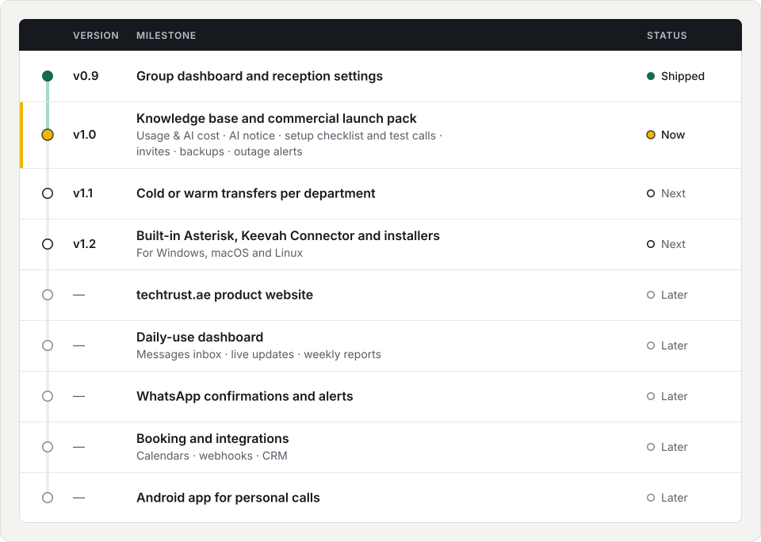

# Keevah roadmap

<picture>
  <source media="(prefers-color-scheme: dark)" srcset="brand/roadmap-dark.svg">
  
</picture>

Where Keevah is, and where it's heading.

- **Shipped:** in a release you can download.
- **Now:** the current release.
- **Next:** what we're working towards.
- **Later:** what we mean to do after that.

Nothing here has a date or is a promise. The order and the details can change as we learn from the people who use Keevah. What has shipped is in the [changelog](CHANGELOG.md).

Follow along on the **Keevah Roadmap** board under this repository's [Projects](https://github.com/b34tl86/Keevah/projects) tab, and tell us what you need in [Discussions → Ideas](https://github.com/b34tl86/Keevah/discussions/categories/ideas). A 👍 on an idea that's already there counts too.

## Shipped

### v0.9 · Group dashboard and reception settings

One dashboard for the whole group and for each organisation: calls and minutes, who's on the line, busiest times, what callers wanted and messages to return. One Settings area for opening hours, call handling, voices, data retention, the email server and sign-in security, and two-step sign-in for everyone.

## Now

### v1.0 · Knowledge base and commercial launch pack

Keeva answers callers from each organisation's own documents, web pages and notes, and lists the questions she couldn't answer. The launch pack adds what you need to run Keevah as a business: usage & AI cost, the AI notice on every call, a setup checklist with test calls, invites by email, nightly encrypted backups and outage alerts.

## Next

### v1.1 · Cold or warm transfers per department

Each department chooses how Keeva puts callers through. Cold: straight through to the department. Warm: Keeva checks with the colleague first, and connects the caller only if they say yes. Today every transfer announces the caller to the colleague before connecting them.

### v1.2 · Built-in Asterisk, Keevah Connector and installers for Windows, macOS and Linux

Keevah brings its own Asterisk, so there's no separate phone server to build, and the Keevah Connector links your phone system to Keevah. Guided installers for Windows, macOS and Linux take over from today's Preview zips, with live calls on all three systems.

## Later

### techtrust.ae product website

A home for Keevah on techtrust.ae: what it does, how to get it, and where to find help.

### Daily-use dashboard: messages inbox, live updates, weekly reports

For the people who use Keevah all day: an inbox for messages, updates as they happen, and a report each week.

### WhatsApp confirmations and alerts

Confirmations for callers, and alerts for your team, on WhatsApp as well as by email.

### Booking and integrations: calendars, webhooks, CRM

Booking appointments into your calendar during a call, and passing calls on to your other systems through webhooks and your CRM.

### Android app for personal calls

Keeva will answer your own mobile calls when you can't.
