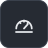
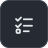

# Keevah brand kit

Keevah looks like its own dashboard: a charcoal sign panel, a cool off-white ground, white board rows on hairlines, one signage yellow for "you are here" and "now", and states written as a dot plus a plain word. Keep it calm, flat and exact: no gradients, no glow, no mascots.

## Files

| File | Use |
| --- | --- |
| `keevah-logo.svg` / `keevah-logo-dark.svg` | The logo (mark and wordmark) for light and dark pages |
| `keevah-mark.svg` | The mark alone: avatars, app icons, small spaces |
| `keevah-favicon.svg` | The mark redrawn on a 32 px grid for 16 and 32 px |
| `hero-light.svg` / `hero-dark.svg` | README hero, 1280 × 420 |
| `how-it-works-light.svg` / `-dark.svg` | Caller → phone system → Keevah → your team |
| `roadmap-light.svg` / `-dark.svg` | The roadmap as a board, v0.9 to the Android app |
| `social-preview.png` / `.svg` | GitHub social preview, 1280 × 640 (the PNG is the upload, the SVG its source) |
| `icons/*.svg` | Feature icons, 48 × 48; one file works on both themes |

Show the light and dark versions with `<picture>`:

```html
<picture>
  <source media="(prefers-color-scheme: dark)" srcset="brand/hero-dark.svg">
  
</picture>
```

To set the social preview, go to the repository's **Settings → General → Social preview** and upload `social-preview.png`.

## The logo


The mark is the dashboard's own wayfinding: the signage-yellow location bar becomes the stem of a K, with a white chevron, on the charcoal sign panel. The wordmark is Fira Sans SemiBold at −0.01 em, outlined. Its cap height matches the mark's K, so the two Ks share a top line and a baseline.

- **Clear space:** keep at least half the mark's height clear on every side (the height of the K).
- **Minimum size:** the logo 20 px tall on screen, and the mark 16 px (use `keevah-favicon.svg` below 32 px).
- **On dark pages** use `keevah-logo-dark.svg`. The mark stays the same in both themes.
- **On the charcoal itself** (#262b33), fill the tile with #323944 so it keeps its edge, as the social preview does.

## Colour

| Role | Light | Dark |
| --- | --- | --- |
| Sign panel (the mark, primary buttons, the rail) | `#262b33` | `#0f1317` |
| Signage yellow: "you are here" and "now" only | `#f2b705` | `#f2b705` |
| Ground | `#f3f4f1` | `#14181d` |
| Board row / card | `#ffffff` | `#1c2127` |
| Board head strip / its labels | `#16191d` / `#b9c1ca` | `#0b0e11` / `#a9b2bc` |
| Ink | `#16191d` | `#e8ebee` |
| Quiet ink | `#565d66` | `#a6afb9` |
| Hairline / rule | `#dcdfd8` / `#e6e8e3` | `#2c333b` / `#262c33` |
| Quiet fill (day strip, empty states) | `#eceee9` | `#232930` |
| Opening hours on the day strip | `#a9d8bc` | `#2f6b4b` |

State colours appear only on a state that means something, and the same way as in the app:

| State | Text on wash (light) | Text on wash (dark) |
| --- | --- | --- |
| Completed, shipped, calls answered (green) | `#146c43` on `#e2f2e9` | `#74d6a3` on `#10291d` |
| Put through (blue) | `#0b5394` on `#e2eefb` | `#8cc4f5` on `#0f2438` |
| Message taken, warnings (amber) | `#84480a` on `#fdf0d5` | `#f3c064` on `#2e2210` |
| Failure (red) | `#a3241a` on `#fbe6e3` | `#f6a39a` on `#34171a` |

## Type

- **Fira Sans**, 400 to 600, for everything; one family, no second display face. It's free under the SIL Open Font Licence.
- **Headlines** are semibold at −0.02 em. **Labels** are 12 to 15 px semibold capitals tracked +0.06 to +0.1 em, and are kept for board heads and eyebrows.
- **Figures** are tabular, so times and counts line up.
- **In the graphics,** text is live `<text>` using `'Fira Sans', -apple-system, 'Segoe UI', Inter, Helvetica, Arial, sans-serif`. GitHub can't load web fonts in images, so each visitor sees Fira Sans if they have it and their system face otherwise. Layouts are checked with Fira Sans, the Mac system face, Arial and Verdana. Only the logo is outlined, and the social preview PNG is rendered in Fira Sans.

## Icons

       
       

The icons are 24-grid line glyphs, drawn with 1.75 strokes and round ends, on a 48 px charcoal tile with an 18.75% radius, the same as the mark. Show them at 32 to 48 px. They are answer, transfer, message, knowledge, dashboard, transcript, email, usage, setup, backups, alerts, pbx, organisations, ai-notice, team and hours. New icons follow the same grid, stroke and tile, and don't use yellow.

## Do

- Use yellow only for "you are here" and "now": the mark's stem, the now-marker on a day strip, the current row on the roadmap.
- Write states as a dot plus a word ("Shipped", "Now", "Calls are being answered"). Colour is never the only signal.
- Keep surfaces flat: separate them with 1 px hairlines and tone, not shadows.
- Use fictional organisations in every picture (Harbourline Logistics, Bluebay Clinic).

## Don't

- Don't recolour, stretch, rotate or outline the mark, or put the wordmark in another face.
- Don't put yellow on buttons, headings or large areas.
- Don't use gradients, glows, drop shadows, illustrations, mascots or stock photos.
- Don't dress it up as an airport: no split-flap cells, LED or dot-matrix type.
- Don't show real customer names, numbers or calls.
